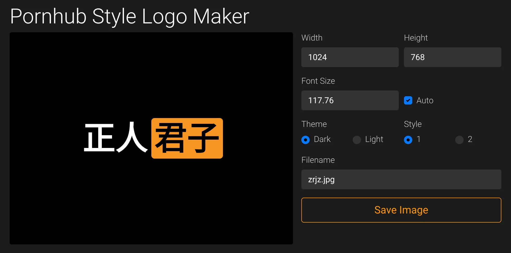
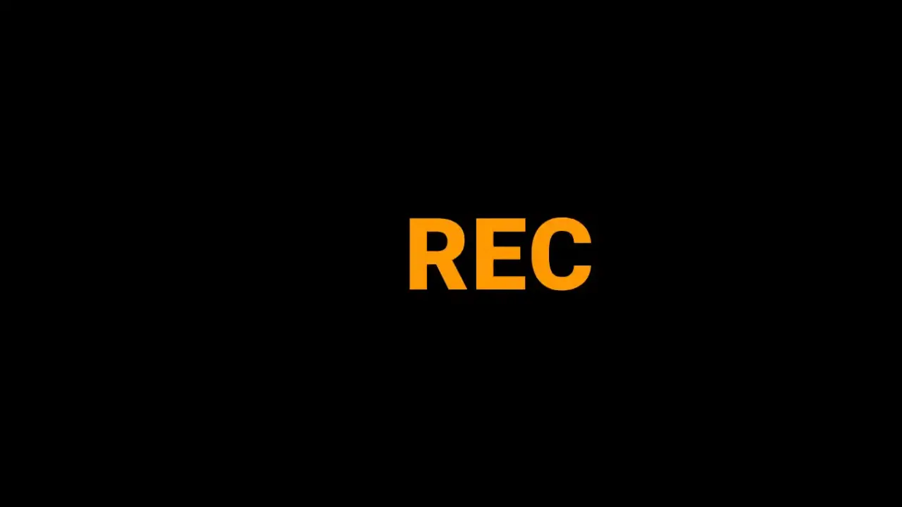
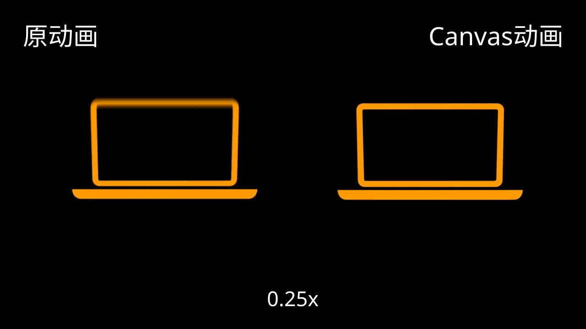
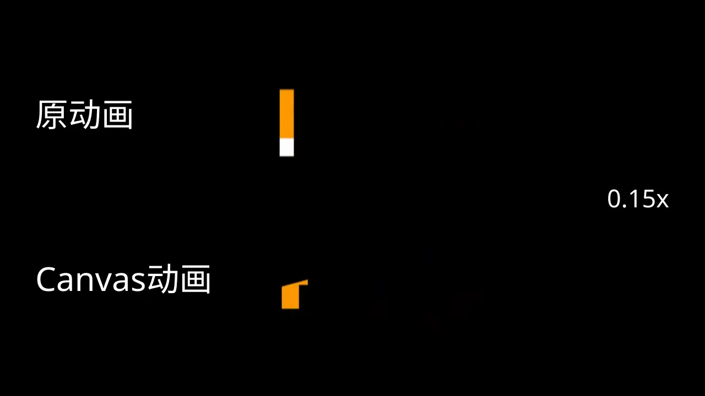
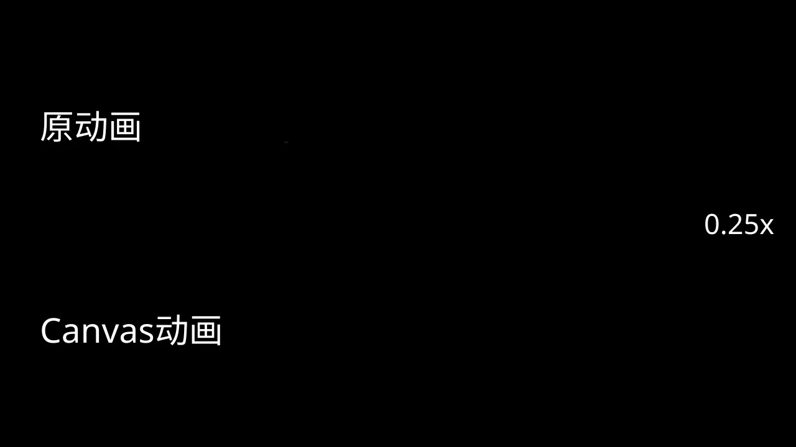
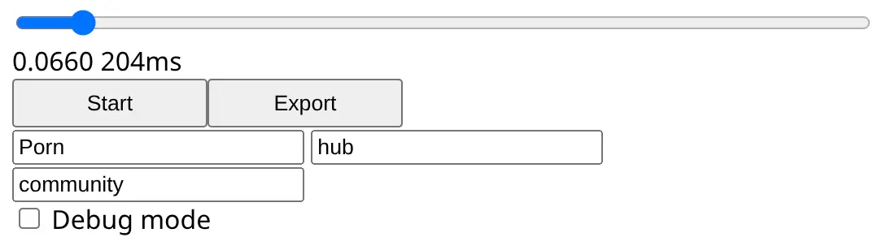

温馨提醒：本文无 NSFW 内容，请放心阅读。

不知道你有没有用过 Pornhub 风格的 logo 生成器，如果没用过，可以去看看 [logoly.pro](https://www.logoly.pro/) 或 [Pornhub Style Logo Maker](https://avisek.github.io/Pornhub-Style-Logo-Maker/) 。



## 做一个片头生成器

回到 2024 年 12 月。

那时我就想：从 Blue Archive 到 Pornhub ，用那些在线工具生成的静态 logo 大家都见过了，那有没有动态的 Pornhub 片头生成器呢？

我搜了一下，没有。

当时的我才刚上高一没多久，很喜欢在手机上折腾 [Termux](https://termux.dev/) ，我就在里面安装了 Node.js ，用 npm 安装了 vite ，用 nvim 编辑代码，编辑完之后去 [Kiwi browser](https://github.com/kiwibrowser/src.next) 里预览。选 Kiwi browser 是因为它有 Chromium 原生 DevTools ，可惜它后来停更了。

我在电脑上用 [IDM](https://www.internetdownloadmanager.com/) 的浏览器插件下载了一个完整的视频，用剪辑软件截取片头部分并导出帧序列。一开始我在相册里看完图片然后去写代码，后来我觉得这样不精准，就把原始的图片画在 Canvas 里做背景，自己在上面叠加动画，我自己的动画尽量和背景对齐。

我没有电话卡，也就没有流量，上不了网。在学校里拿着手机没事干的时候，就打开 Termux 写代码。就这样干了一两周，后面就放弃了。

## 重做

现在再搜，有一些视频模板，需要导入剪辑软件才能编辑，也有的可以像那些 logo 生成器一样在线生成，但是是后端的，而且要付费。总之，没有一个像样的 Pornhub 片头生成器，看来还是得自己做。

时隔接近两年，2026 年 9 月，我捡起这个半途而废的项目，几乎是从头再做了一遍。

### 下载片头

之前我用 IDM 的浏览器插件下载视频，这次我用了 [yt-dlp](https://github.com/yt-dlp/yt-dlp) ，它可以只下载视频的前几秒。

在 Pornhub 网页上随便找一个有 1080p 的视频，复制链接，yt-dlp 默认会下载那个视频的最高画质。

```shell
./yt-dlp_linux --download-sections "*00:00-00:04" "PORNHUB_VIDEO_URL"
```

不知道是不是因为我的 VPN 的 IP reputation 的问题，yt-dlp 有时候获取不了视频信息，我给他们开了一个 issue ([#17642](https://github.com/yt-dlp/yt-dlp/issues/17642)) 。后来发现无法获取元数据其实不影响下载。

接下来用 FFmpeg 把视频拆成帧序列：

```shell
ffmpeg -i ../ph-intro.mp4 -c:v libwebp %03d.webp
```

需要指定`-c:v libwebp`参数，否则 FFmpeg 会默认使用`libwebp_anim`编码器生成 WebP 动图。别的图片格式，比如 jpeg ，应该没这个问题。

### 环境

首先把 Node 换成 Deno ，因为 VSCode 可以用 Deno 的 LSP 。曾经我非常喜欢 WebStorm ，但是它太重了。

```shell
deno init --empty
rm main.ts # deno init 会自动创建这个文件
deno add vite
```

## 动画

明明只用做结尾那一小段的动画，前面的部分用下载的视频就行了，为什么要用 Canvas API 实现整个动画呢？

第一，质量。原视频太糊、帧率太低，如果不统一的话，看着难受。~~其次，我想折腾。~~

既然要复刻，那就得追求尽量贴合原本的动画。

（先用取色器获得 Pornhub 的主题色：`#FF9900`）

我把动画分成4个阶段：

### REC

这部分是最简单的，就是画一个圆和"REC"，让它们的 Y 坐标随时间增加。



### 笔记本电脑

首先是笔记本底座。它一眼看过去是倒过来的圆角梯形，但我把图片放到 Inkscape 里，发现它其实更贴近 Y 轴较长的 1/4 椭圆。Canvas API 有自带画椭圆的函数`ellipse()`，很好画。

然后是笔记本屏幕，这个难一些。

因为它有一个翻转的动画，上底的长度要变化，是个梯形，Canvas API 自带的`roundRect()`函数就没法用了。Canvas API 没有提供画圆角梯形的函数，需要自己用`arcTo()`画。

我没有选择`ctx.stroke()`一次性画出来，而是先画内外两个圆角梯形，再，这样可以更精细地控制边框宽度和圆角大小。

步骤：

1. 画外边框，上底、高和 Y 坐标需要动画
2. 画内边框
3. 用`ctx.fill("evenodd")`，只会填充内外边框之间的部分

最后是屏幕里面的“上传”图标。

它进入屏幕时，在屏幕之外的那一部分要裁切掉，这就需要用到 Canvas API 的`ctx.clip()`

步骤：

1. 用`ctx.save()`保存 Canvas 状态
2. 画一个矩形，大致是屏幕的大小
3. `ctx.clip()`，接下来绘制的内容，在矩形之外的部分会被裁切掉
4. 画圆形，它的 Y 坐标和半径都需要动画
5. 用黑色在圆形上画箭头，箭头的三角形和矩形分开画
6. `ctx.restore()`还原裁切

### “播放”按钮

首先画圆

1. 画外圆，半径和 Y 坐标需要动画
2. 画内圆
3. 用`ctx.fill("evenodd")`

和画笔记本屏幕差不多。

然后画圆里面的三角形。笔记本电脑有一个“上传”图标，现在要把它变换成“播放”按钮里的三角形。

一开始我直接把原本三角形的三个顶点，分别用线性动画移到新的位置，在 Inkscape 里量好坐标就行了。如果真正去旋转三角形，变量太多：底的长度、高的长度、旋转角度、旋转中心。

缺点就是，画的时候就会变形：


虽然变换的时间极短，如果不慢放的话，看不出来。但我还是得追求完美，做一个真正的旋转动画。

1. `ctx.translate()`到旋转中心
2. `ctx.rotate()`旋转
3. `ctx.translate()`回到左上角原点
4. 画三角形
5. `ctx.setTransform({})`

很多人用`ctx.setTransform(1, 0, 0, 1, 0, 0)`，其实它也接受一个 object ，object 中没有的值就是默认。

最后是鼠标指针。在 Inkscape 里量好坐标，然后用`ctx.translate()`移动。



### 文字

最难的部分，就是画字，因为 Porn 和 hub 的长度会影响它们的位置，也会影响 community 的位置。

总体过程：

1. `ctx.measureText()`测量三个文字的宽度
2. 通过 Porn 和 hub 的宽度决定它们的位置
3. 画出 Porn 和 hub
4. 画出 community

这三段文字都有不同的动画

#### Porn


原版动画是针对这四个字做的，我不知道用户会输入什么字，没法针对每个字去优化，只能做一个大概的，尽量贴合原版动画。

画每个字的过程：

1. `ctx.save()`保存状态
2. `ctx.arc()`画出一个扇形，圆心角有动画
3. `ctx.clip()`裁剪
4. `ctx.fillText()`画出那个字，用橙色
5. `ctx.restore()`还原裁剪
6. 再画一个扇形，圆心角比第一个扇形小一些
7. `ctx.clip()`裁剪
8. 画字，用白色
9. `ctx.restore()`还原



#### hub

步骤：

1. `ctx.translate()`，移动原点到旋转中心
2. `ctx.rotate()`旋转画布，角度有动画
3. `ctx.scale()`放大画布，倍数有动画
4. `ctx.roundRect()`画圆角矩形
5. `ctx.fillText()`画出文字
5. `ctx.setTransform()`还原

#### community

community 的左右两侧和 Porn hub 的两侧对齐。

画每个字的步骤：

1. `ctx.save()`
2. `ctx.translate()`移动到字的左下角
3. `ctx.rect()`画一个矩形，从字的左下角开始，向右上画，宽度和高度足够
4. `ctx.clip()`裁剪，字底部以下的部分会被裁剪掉
5. `ctx.rotate()`旋转画布，角度有动画
6. `ctx.fillText()`画出字
7. `ctx.restore()`还原

重复这几个步骤，依次画出每一个字



## 声音

从视频里提取声音：

```shell
ffmpeg -i ph-intro.mp4 -c:v none -c:a copy -t 00:00:03.1 sound.aac
```

放到和 index.ts 相同的目录

在 Typescript 里：

```typescript
import soundUrl from "./sound.aac" // Vite 会自动把它转为 URL

const audio = new Audio(soundUrl)

// 播放
await audio.play()

// 暂停
audio.pause()

// 跳转到开头
audio.currentTime = 0
```

## 导出

如果只能在 canvas 里播放而不能导出视频，这东西做出来就是个摆设。

### MediaRecorder

我在手机上开发的时候，用 [Canvas.captureStream()](https://developer.mozilla.org/docs/Web/API/HTMLCanvasElement/captureStream) 和 [MediaRecorder](https://developer.mozilla.org/docs/Web/API/MediaRecorder) 录制 canvas ，但是它缺点很明显：

第一，因为 Web workers 里可用的 [OffscreenCanvas](https://developer.mozilla.org/en-US/docs/Web/API/OffscreenCanvas) 不支持录制，所以只能在 DOM 里的 canvas 播放，这就需要等待 3s ，虽然看起来不长，但是很影响体验。

第二，导出的视频在本地播放会很卡，用 FFmpeg 拆成一帧一帧来看倒是没什么问题。原因未知。

最重要的是，它录不了声音。

### WebCodecs API

[WebCodecs API](https://developer.mozilla.org/docs/Web/API/WebCodecs_API) 看起来不错，可以逐帧喂数据，然后编码成视频，但它没有自带的 muxer ，放不了音频。所以我就找到了第三方库 [Mediabunny](https://mediabunny.dev/) 。

### Mediabunny

底层用的还是 WebCodecs API ，但多了很多功能，也好用很多。可以说是浏览器里的 FFmpeg 。

```shell
deno install mediabunny
```

```text
[UrlSource]
    ↓
[Input]
    ↓
[InputAudioTrack]
    ↓
[EncodedPacketSink]
    ↓
[EncodedAudioPacketSource] >----↓
                              [Output] ----[Mp4OutputFormat]
[CanvasSource] >----------------|       |--[BufferTarget]
    ↑                      
[OffscreenCanvas]
```

一开始我放在 Worker 里面渲染，但 Worker 和主线程通信比较麻烦，构建时好像还不能打包成一个脚本。后来发现渲染非常快，只花了不到 1s ，几乎感受不到，我就放在主线程了。

## UI

测试的时候，UI 是这个样：



加一点 CSS 样式之后：


借鉴了 Material 3 的风格，但不是标准的 M3 。

## 完成

最终效果：

<video src="./zrjz.mp4" controls></video>

### Kdenlive

这篇博客里的几个演示动画都是导出后在 [Kdenlive](https://kdenlive.org/) 里编辑的。

GIF 格式一点都不好用，压缩率太低，所以我用 WebP 。

在渲染的窗口里，新建一个 WebP 预设，设置容器为 webp ，视频编码器用 libwebp_anim ，添加额外参数`loop=0`，否则不会循环播放。这个就是 FFmpeg 的参数。

### draft 分支

我在 Termux 上做到一半，还有没有 push 到 GitHub 上的 commits 。重做的时候，我直接从 GitHub 上下载了已经上传的部分继续做。其实我有 Termux 的备份，但是我当时想着，反正都要重做了，从哪开始都差不多。

把之前在手机上写到一半的代码也上传了吧。从当时备份的 Termux 用户目录里提取出项目，然后：

```shell
cd ~/proj/ph-intro-backup
git add .
git commit # 旧仓库里还有未提交的更改

cd ~/proj/ph-intro
# 从本地的旧仓库导入 branch
git fetch file:///home/tanky/proj/ph-intro-backup master:draft
git push -u origin draft:draft
```

把它放到了`draft`分支上。
